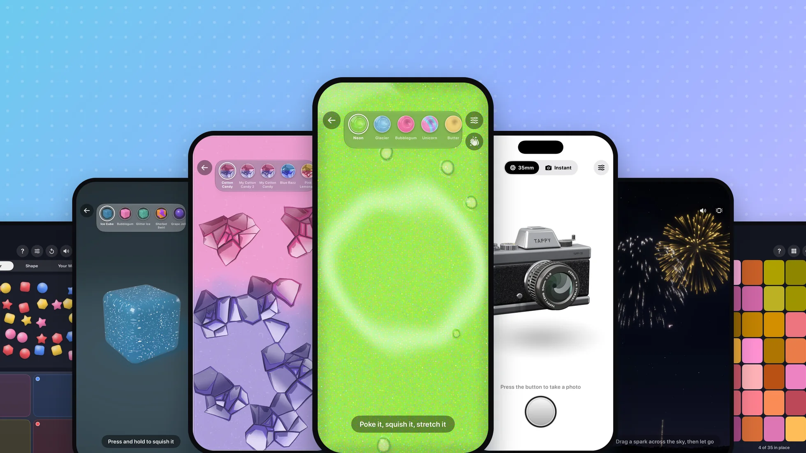

# tappy.net

Static site served by GitHub Pages. There is no build step: edit the HTML, then preview with

```sh
python3 -m http.server 8765 --bind 127.0.0.1
```

and open http://127.0.0.1:8765/.

## Newsroom

The Newsroom lives at `/newsroom/`. Each post is a folder with its own `index.html`, and its images live in a matching folder under `/assets/newsroom/`:

```
newsroom/
  index.html                                   the Newsroom front page
  rss.xml                                      feed
  2026/11/tappy-6-7-adds-11-new-fidgets/       one post
    index.html
assets/newsroom/2026/11/tappy-6-7/             that post's images
  hero.webp, hero-og.jpg, <screen>.webp
  download/tappy-6-7-<screen>.jpg
  tappy-6-7-media.zip
```

Styles are in `assets/css/newsroom.css`. The Copy text, Share and gallery buttons are handled by `assets/js/newsroom.js`.

### Adding a post

1. **Take screenshots.** Use the iPhone 17 Pro simulator with a clean status bar:
   `xcrun simctl status_bar booted override --time 9:41 --batteryState charged --batteryLevel 100`.
   Then `xcrun simctl io booted screenshot ~/Desktop/shots/<name>.png`. Name each PNG the way it should appear in URLs, for example `slime.png`.

2. **Build the images.** You need Pillow (`pip3 install pillow`). Run:

   ```sh
   python3 tools/newsroom-media.py assets/newsroom/2026/12/tappy-6-8 ~/Desktop/shots/*.png \
       --hero left,center-left,center,center-right,right
   ```

   This writes:
   - A 603px-wide `<name>.webp` for the page.
   - A full-size `download/tappy-6-8-<name>.jpg`.
   - `hero.webp` (1960×1102) and `hero-og.jpg` (1200×630, for social previews), built from 3, 5 or 7 of the screenshots.
   - `tappy-6-8-media.zip`.

   **Video clips (optional).** Record with `xcrun simctl io booted recordVideo --codec=h264 clip.mp4` and stop it with Ctrl-C. Then trim it to a short loop at page size, without sound:

   ```sh
   ffmpeg -i clip.mp4 -ss 2 -t 10 -vf "fps=30,scale=604:-2,format=yuv420p" -an \
       -c:v libx264 -crf 25 -movflags +faststart assets/newsroom/2026/12/tappy-6-8/download/tappy-6-8-<name>.mp4
   ```

   Save the first frame as `<name>-poster.webp`. Add the clips before running `newsroom-media.py`, so they're included in the ZIP.

3. **Write the article.** Copy the latest post folder to `newsroom/YYYY/MM/<slug>/`, then update:
   - The `<title>`, description, canonical URL, the `og:*` and `twitter:*` tags, and `article:published_time`.
   - The JSON-LD `NewsArticle` (headline, dates, image) and the `BreadcrumbList`.
   - The kicker date, headline, dek, body, captions and the "Media in this article" grid.

   The body building blocks are:
   - `.nr-figure` with `.nr-panel` for one to three phones on a tinted panel. Set the color with `style="--tint:var(--mint-soft)"`, or use the `is-night` class.
   - `.nr-gallery` for a swipeable set of screenshots with its own caption and Download link.
   - A `<video muted loop playsinline>` inside a `.nr-phone`, on a panel marked `data-video` with a `data-video-toggle` button. It plays while on screen and has a pause button. See the Slime and Wax Cracking panels in the 6.7 post.
   - `.nr-caption` under each figure.

4. **Update the Newsroom front page** (`newsroom/index.html`):
   - Point the `.nr-feature` block at the new post.
   - Move the previous story into a "Latest news" grid below it. Add this once, right after `.nr-feature`, then add one tile per older post:

     ```html
     <h2 class="nr-section-title">Latest news</h2>
     <div class="nr-grid">
         <a class="nr-tile" href="/newsroom/2026/11/tappy-6-7-adds-11-new-fidgets/">
             
             <div class="nr-tile-body">
                 <span class="nr-kicker">Press release</span>
                 <h3>Tappy 6.7 adds 11 new fidgets, from slime to fireworks</h3>
                 <span class="nr-kicker"><time datetime="2026-11-13">November 13, 2026</time></span>
             </div>
         </a>
     </div>
     ```

   - Add the post to the `ItemList` in the page's JSON-LD, newest first, and renumber `position`.

5. **Update the feeds.**
   - Add an `<item>` to the top of `newsroom/rss.xml`. Set its `<enclosure length>` to the byte size of `hero-og.jpg`.
   - Add a `<url>` to `sitemap.xml`.
   - Update "Latest version" in the press kit fact sheet (`press/index.html`).

6. **Check the copy.** Describe what a fidget looks, sounds and feels like. Don't make health or medical claims (ADHD, autism, anxiety, therapy, "stress relief" and the like), and don't promise outcomes.
